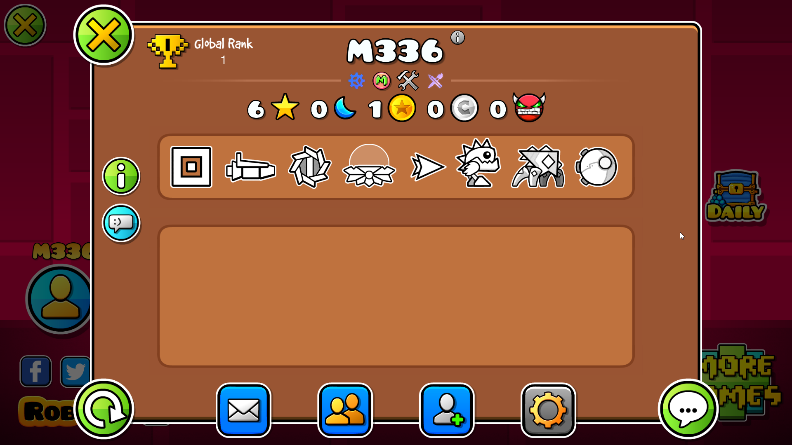
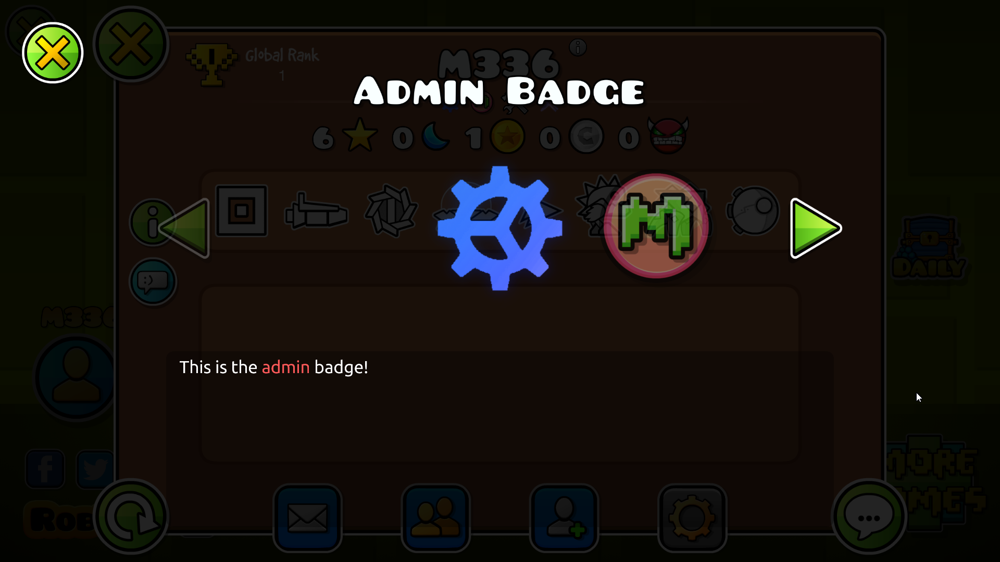
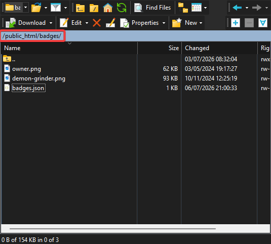
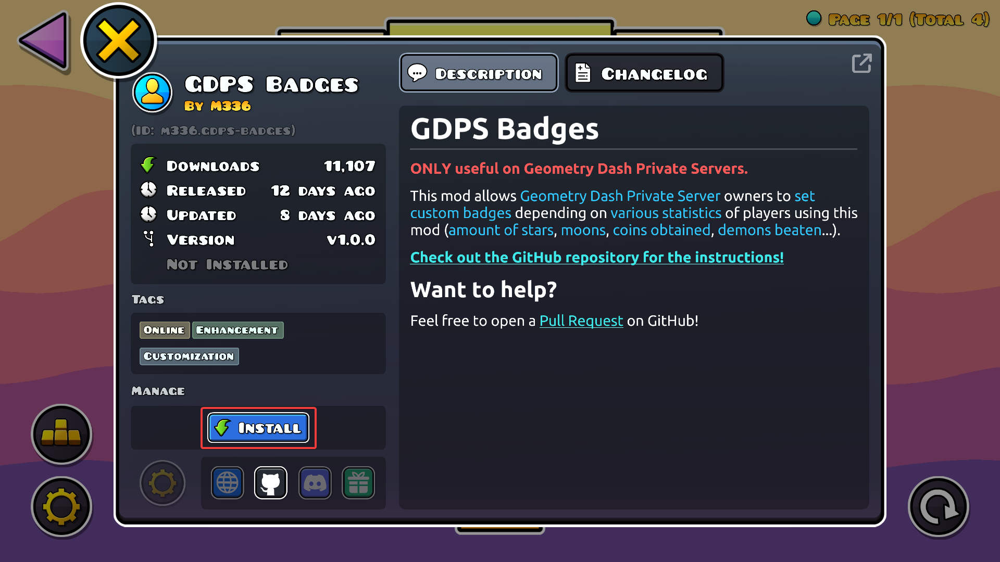

:::caution
Контент перевода на этой странице устарел. Если вы хотите увидеть более актуальную информацию, вы всё ещё можете [ознакомиться с этим руководством на английском языке, нажав здесь](../../../en/gdps/adding-custom-badges/).
:::

Это руководство покажет, как добавить кастомные бейджики вашим игрокам прямо в игре с помощью [мода GDPS Badges](https://geode-sdk.org/mods/m336.gdps-badges)!





*Это руководство в основном предназначено для владельцев/администраторов GDPS; если вы обычный игрок, вам стоит подождать, пока ваш GDPS объявит о совместимости с этим модом, чтобы увидеть кастомные бейджики в игре.*

## Требования
Чтобы выполнить остальные шаги этого руководства, убедитесь, что:
- У вас есть полный доступ к SFTP вашего GDPS
- Вы уже создали несколько кастомных бейджиков, которые хотите добавить (в конце концов, в этом и суть руководства… не так ли? *Рекомендуемое разрешение — 92x92, мод принимает только формат PNG.*)

## Создание badges.json
В SFTP перейдите в публичный корневой каталог вашего GDPS (обычно `public_html`) и создайте новую папку `badges`; здесь вы будете задавать свойства бейджиков и добавлять их текстуры.

Внутри папки `badges` создайте файл `badges.json` и заполните его по этому примеру:
```json
[
    {
        "id": "owner",
        "name": "Owner",
        "description": "Это <cr>владелец</c> этого GDPS!",
        "requirements": {
            "players": [ 72 ]
        }
    },
    {
        "id": "demon-grinder",
        "name": "Demon Grinder",
        "description": "Этот игрок прошёл более <cr>2 500</c> уровней сложности Demon!",
        "requirements": {
            "minDemons": 2500,
            "maxDemons": 9999
        }
    }
]
```

### Возможные требования
| Параметр | Описание | Пример |
| --- | --- | --- |
| `players` | Белый список ID аккаунтов, которые могут иметь бейджик | `"players": [ 72, 73, 74 ]` |
| `modBadge` | Добавляет кастомный бейджик при наличии одного из бейджиков модератора. Может быть `leaderboard`, `elder` или `regular` | `"modBadge": "elder"` |
| `minRank` | Минимальный глобальный ранг, необходимый для получения бейджика | `"minRank": 1` |
| `maxRank` | Максимальный глобальный ранг, допустимый для получения бейджика | `"maxRank": 100` |
| `minStars` | Минимальное количество звёзд, необходимое для получения бейджика | `"minStars": 1000` |
| `maxStars` | Максимальное количество звёзд, допустимое для получения бейджика | `"maxStars": 5000` |
| `minMoons` | Минимальное количество лун, необходимое для получения бейджика | `"minMoons": 500` |
| `maxMoons` | Максимальное количество лун, допустимое для получения бейджика | `"maxMoons": 2000` |
| `minGoldCoins` | Минимальное количество секретных монет, необходимое для получения бейджика | `"minGoldCoins": 50` |
| `maxGoldCoins` | Максимальное количество секретных монет, допустимое для получения бейджика | `"maxGoldCoins": 164` |
| `minSilverCoins` | Минимальное количество пользовательских монет, необходимое для получения бейджика | `"minSilverCoins": 100` |
| `maxSilverCoins` | Максимальное количество пользовательских монет, допустимое для получения бейджика | `"maxSilverCoins": 500` |
| `minDemons` | Минимальное количество пройденных демонов, необходимое для получения бейджика | `"minDemons": 10` |
| `maxDemons` | Максимальное количество пройденных демонов, допустимое для получения бейджика | `"maxDemons": 100` |

## Добавление иконок бейджиков
Теперь просто перетащите имеющиеся текстуры в папку `badges`.
Убедитесь, что имя файла совпадает с ID, который вы указали для соответствующего бейджика в `badges.json`!

Например, если вы хотите добавить текстуру для бейджика «Demon Grinder», показанного выше, перетащите файл с именем `demon-grinder.png`.


## Распространение мода
Теперь просто сообщите игрокам, что ваш GDPS совместим с модом:
- Либо [скачав его вручную](https://geode-sdk.org/mods/m336.gdps-badges) и поместив в папку модов Geode,
- Либо, прямо в игре, скачав его **из индекса** как показано ниже:


-----

*Перевела [elixia](https://t.me/elixiadev)*

*Последнее обновление: 15 июля 2026 года*