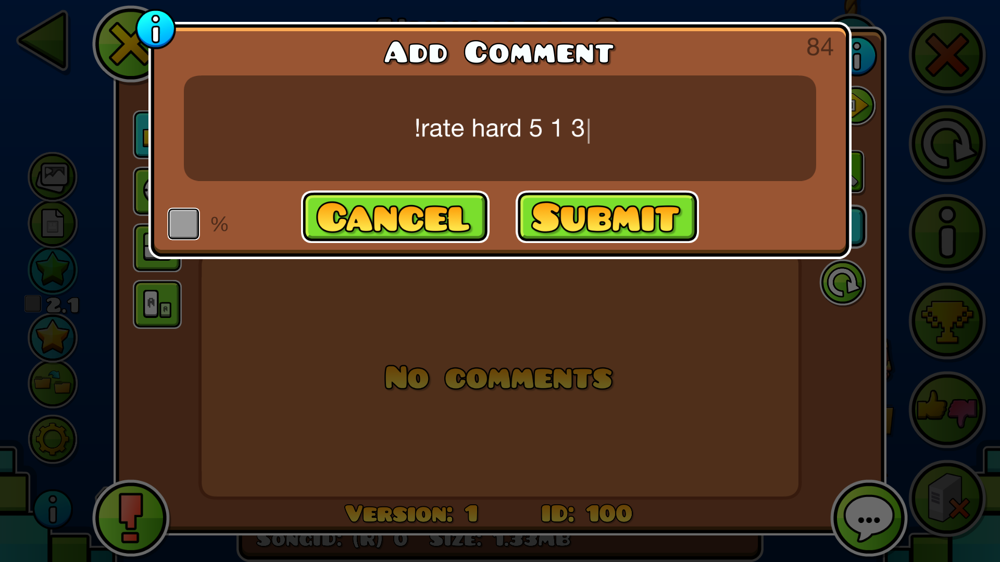
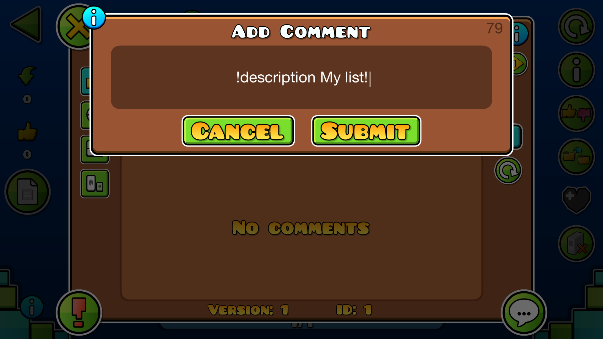
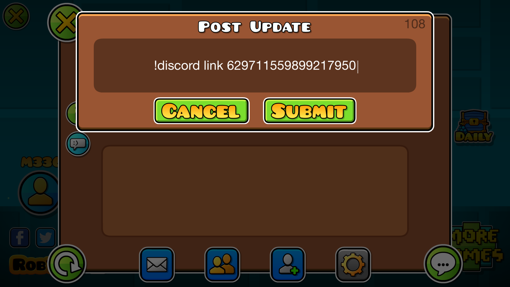

Это все команды, доступные на GDPS, использующем [форк GMDprivateServer от MegaSa1nt](https://github.com/MegaSa1nt/GMDprivateServer/tree/master)!

*У некоторых команд есть необязательные аргументы, не указанные здесь для простоты.*

## Команды уровней
Эти команды можно использовать в разделе комментариев под уровнем!

### Оценка
| Команда | Разрешение | Описание |
| --- | --- | --- |
| `!rate` / `!r <сложность> <звёзды> <монетки> <feature>` | `commandRate` | Оценивает уровень. `сложность`: `auto`, `easy`, `normal`, `hard`, `harder`, `insane` или `demon`. `монетки`: `1` = вкл, `0` = выкл. `feature`: `0` = только оценка, `1` = featured, `2` = epic, `3` = legendary, `4` = mythic. |
| `!unrate` / `!unr` | `commandRate` | Полностью снимает оценку с уровня. |
| `!send <сложность> <звёзды> <feature>` | `actionSuggestRating` | Отправляет уровень на оценку. `сложность`: `auto`, `easy`, `normal`, `hard`, `harder`, `insane` или `demon`. `feature`: `0` = только оценка, `1` = featured, `2` = epic, `3` = legendary, `4` = mythic. |
| `!unsend` | `actionSuggestRating` | Полностью отменяет отправку уровня. |

### Feature
| Команда | Разрешение | Описание |
| --- | --- | --- |
| `!feature` / `!f` | `commandFeature` | Делает уровень Featured. |
| `!epic` | `commandEpic` | Делает уровень эпическим. |
| `!legendary` | `commandEpic` | Делает уровень легендарным. |
| `!mythic` | `commandEpic` | Делает уровень мифическим. |
| `!unfeature` | `commandFeature` | Снимает статус Featured. |
| `!unepic` | `commandEpic` | Снимает эпический статус. |
| `!unlegendary` | `commandEpic` | Снимает легендарный статус. |
| `!unmythic` | `commandEpic` | Снимает мифический статус. |

### Daily
| Команда | Разрешение | Описание |
| --- | --- | --- |
| `!daily` / `!da` | `commandDaily` | Устанавливает уровень как следующий ежедневный. |
| `!weekly` / `!w` | `commandWeekly` | Устанавливает уровень как следующий еженедельный. |
| `!event` / `!ev <minutes> <reward ID> <amount>` | `commandEvent` | Устанавливает уровень как следующий ивент-уровень на указанное время. Чтобы добавить несколько наград: `!event <minutes> <reward ID> <amount> <reward ID> <amount>...` [Идентификаторы наград](#награды). |

### Монетки и очки создателя
| Команда | Разрешение | Описание |
| --- | --- | --- |
| `!verifycoins` / `!vc` | `commandVerify` | Верифицирует монетки уровня. |
| `!unverifycoins` | `commandVerify` | Снимает верификацию с монеток уровня. |
| `!sharecp <username>` | `commandSharecpOwn` / `commandSharecpAll` | Делится очками создателя за уровень с другим пользователем. |

### Управление
| Команда | Разрешение | Описание |
| --- | --- | --- |
| `!setacc` / `!sa <username/account ID>` | `commandSetacc` | Меняет создателя уровня. |
| `!lockUpdating` / `!lu` | `commandLockUpdating` | Запрещает создателю обновлять уровень. |
| `!unlockUpdating` / `!unlu` | `commandLockUpdating` | Снова разрешает создателю обновлять уровень. |
| `!rename` / `!re <name>` | `commandRenameOwn` / `commandRenameAll` | Переименовывает уровень. |
| `!description` / `!desc <description>` | `commandDescriptionOwn` / `commandDescriptionAll` | Изменяет описание уровня. |
| `!song` / `!s <song ID>` | `commandSongOwn` / `commandSongAll` | Меняет песню уровня. |
| `!public` / `!pub` | `commandPublicOwn` / `commandPublicAll` | Делает уровень публичным. |
| `!unlist` | `commandUnlistOwn` / `commandUnlistAll` | Скрывает уровень. |
| `!ldm` | `commandLdmOwn` / `commandLdmAll` | Включает LDM на уровне. |
| `!unldm` | `commandLdmOwn` / `commandLdmAll` | Выключает LDM на уровне. |
| `!password` / `!pass` / `!p <6 digits>` | `commandPassOwn` / `commandPassAll` | Устанавливает пароль для копирования уровня. Отправьте `000000`, чтобы убрать его. |
| `!lockComments` / `!lc` | `commandLockCommentsOwn` / `commandLockCommentsAll` | Закрывает комментарии под уровнем. |
| `!unlockComments` / `!unlc` | `commandLockCommentsOwn` / `commandLockCommentsAll` | Открывает комментарии под уровнем. |
| `!delete` / `!delet` / `!d` | `commandDelete` | Удаляет уровень. |

## Команды листов
Эти команды можно использовать в разделе комментариев под листом!

### Оценка и Feature
| Команда | Разрешение | Описание |
| --- | --- | --- |
| `!rate` / `!r <награда> <сложность> <featured> <количество>` | `commandRate` | Оценивает лист. `сложность`: `auto`, `easy`, `normal`, `hard`, `harder`, `insane` или `demon`. `featured`: `0` = только оценка, `1` = featured. `количество`: сколько уровней нужно пройти для получения награды. Если есть только `actionSuggestRating`, команда вместо этого предлагает лист на оценку. [Идентификаторы наград](#награды). |
| `!feature` / `!f` | `commandFeature` | Делает лист Featured. |
| `!unfeature` | `commandFeature` | Снимает статус Featured. |

### Управление
| Команда | Разрешение | Описание |
| --- | --- | --- |
| `!rename` / `!re <name>` | `commandRenameOwn` / `commandRenameAll` | Переименовывает лист. |
| `!description` / `!desc <description>` | `commandDescriptionOwn` / `commandDescriptionAll` | Изменяет описание листа. |
| `!setacc` / `!sa <username/account ID>` | `commandSetacc` | Меняет создателя листа. |
| `!unlist` | `commandUnlistOwn` / `commandUnlistAll` | Скрывает лист. Используйте `!unlist 0`, чтобы сделать его публичным, и `!unlist 1` — только для друзей. |
| `!lockComments` / `!lc` | `commandLockCommentsOwn` / `commandLockCommentsAll` | Закрывает комментарии под листом. |
| `!unlockComments` / `!unlc` | `commandLockCommentsOwn` / `commandLockCommentsAll` | Открывает комментарии под листом. |
| `!delete` / `!d` | `commandDelete` | Удаляет лист. |

## Команды профиля
Эти команды можно использовать в разделе комментариев под вашим профилем! Работают только если GDPS поддерживает привязку Discord-аккаунтов.

| Команда | Описание |
| --- | --- |
| `!discord link <discord ID>` | Начинает процесс привязки и отправляет 4-значный код в личные сообщения. |
| `!discord accept <code>` | Привязывает ваш профиль к Discord-аккаунту, если код верный. |
| `!discord unlink` | Отвязывает ваш профиль от Discord-аккаунта. |

## Награды
Это ID для каждого типа наград.

### Shard-награды
| ID | Награда |
| --- | --- |
| **1** | Fire Shard |
| **2** | Ice Shard |
| **3** | Poison Shard |
| **4** | Shadow Shard |
| **5** | Lava Shard |
| **10** | Earth Shard |
| **11** | Blood Shard |
| **12** | Metal Shard |
| **13** | Light Shard |
| **14** | Soul Shard |

### Icon-награды
| ID | Награда |
| --- | --- |
| **1001** | Cube |
| **1002** | Color 1 |
| **1003** | Color 2 |
| **1004** | Ship |
| **1005** | Ball |
| **1006** | UFO |
| **1007** | Wave (Dart) |
| **1008** | Robot |
| **1009** | Spider |
| **1010** | Trail |
| **1011** | Death Effect |
| **1013** | Swing |
| **1014** | Jetpack |
| **1015** | Ship fire |

### Другие награды
| ID | Награда |
| --- | --- |
| **6** | Demon Key |
| **7** | Orbs |
| **8** | Diamond |
| **15** | Gold Key |
| **1012** | Items (keys, paths, gems, music hack, etc.) |

-----

*Перевела [elixia](https://t.me/elixiadev)*

*Последнее обновление: 14 июля 2026 года*