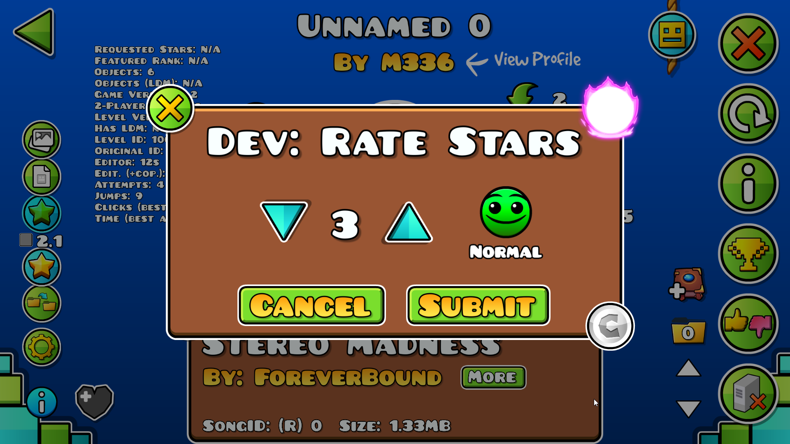
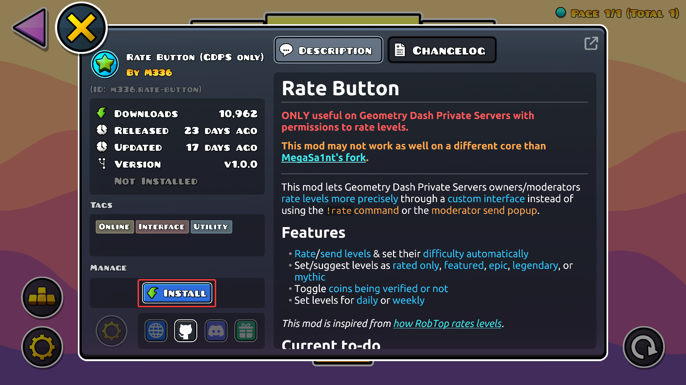
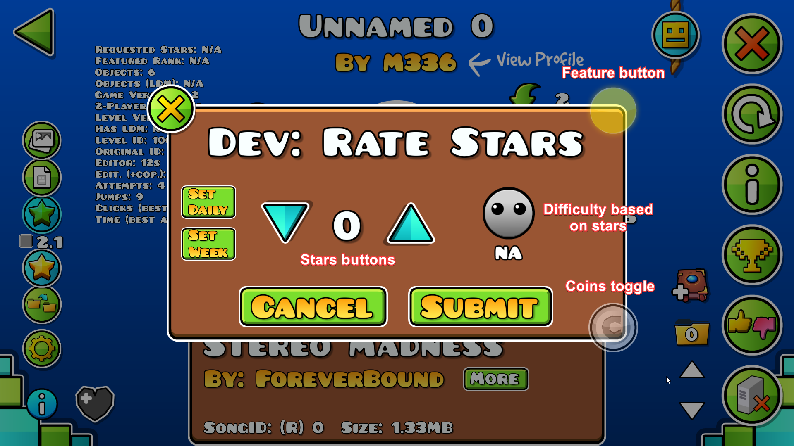
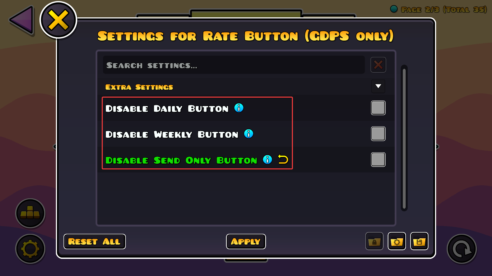

:::caution
Контент перевода на этой странице устарел. Если вы хотите увидеть более актуальную информацию, вы всё ещё можете [ознакомиться с этим руководством на английском языке, нажав здесь](../../../en/gdps/custom-rate-button/).
:::

Это руководство покажет, как получить интерфейс, [который использует RobTop](https://www.youtube.com/watch?v=_wmWuymEZDs), для рейта уровней на GDPS с помощью мода для Geode!

## Вступление
Этот мод не ограничивается лишь оценкой уровней на GDPS; он также создан для того, чтобы:
- Рейтить уровни, не выясняя, какие именно права для этого нужны; внутри он использует команды `!rate` и `!unrate`, но добавляет к ним удобный интерфейс!
- Работать без бейджика модератора и без нажатия кнопки «Req.» в настройках игры. Вам нужно лишь [необходимое право](#требования). *Это позволяет рейтить уровни, даже если у вас бейджик Leaderboard-модератора!*
- Быть максимально интуитивным: назначение каждой кнопки понятно, без скрытых значений

## Требования
Чтобы выполнить остальные шаги этого руководства, убедитесь, что:
- Вы используете GDPS (*[GDPS Switcher](https://geode-sdk.org/mods/km7dev.gdps-switcher) тоже подойдёт*)
- У вас включено право `commandRate` *(да... и это всё)*
- Вы используете [Geode v5.7.1 или новее](https://geode-sdk.org/install)

## Установка мода
Установить мод очень просто!
- Либо [скачайте его вручную](https://geode-sdk.org/mods/m336.rate-button) и поместите в папку модов Geode,
- Либо, прямо в игре, скачайте его **из индекса** как показано ниже:

## Использование мода
После того как вы скачаете мод и перезапустите игру, при нажатии на уровень вы заметите новую синюю кнопку. Она открывает интерфейс для оценки уровней!
- Нажатие на стрелки **вниз** и **вверх** **уменьшает** или **увеличивает** **количество звёзд**, которое будет присвоено уровню (сложность устанавливается автоматически на основе этого)
- Нажатие на **кнопку feature** позволяет выбрать, будет ли уровень просто **оценён**, **featured**, **эпическим**, **легендарным** или **мифическим**
- Нажатие на **кнопку монет** включает или отключает **верификацию** **монет**

*Если установить 0 звёзд и нажать Submit, оценка с уровня будет полностью снята, даже если вы выбрали статус feature или включили монеты.*

## Дополнительные функции
В настройках мода также можно включать и отключать следующие дополнительные кнопки:
- Кнопка **Set Daily** позволяет установить уровень как следующий ежедневный (требуется право `commandDaily`)
- Кнопка **Set Week** позволяет установить уровень как следующий еженедельный (требуется право `commandWeekly`)
- Кнопка **Send Only** позволяет предложить уровень вместо того, чтобы оценивать его (требуется право `actionSuggestRating`)

-----

*Перевела [elixia](https://t.me/elixiadev)*

*Последнее обновление: 12 июля 2026 года*