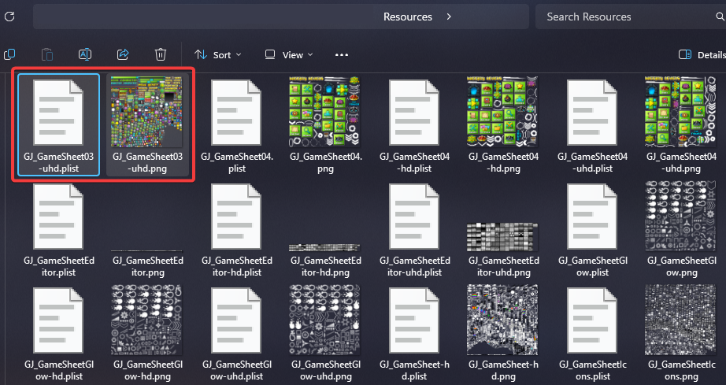
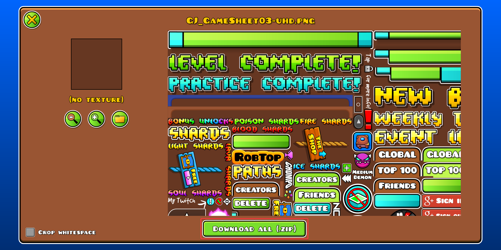
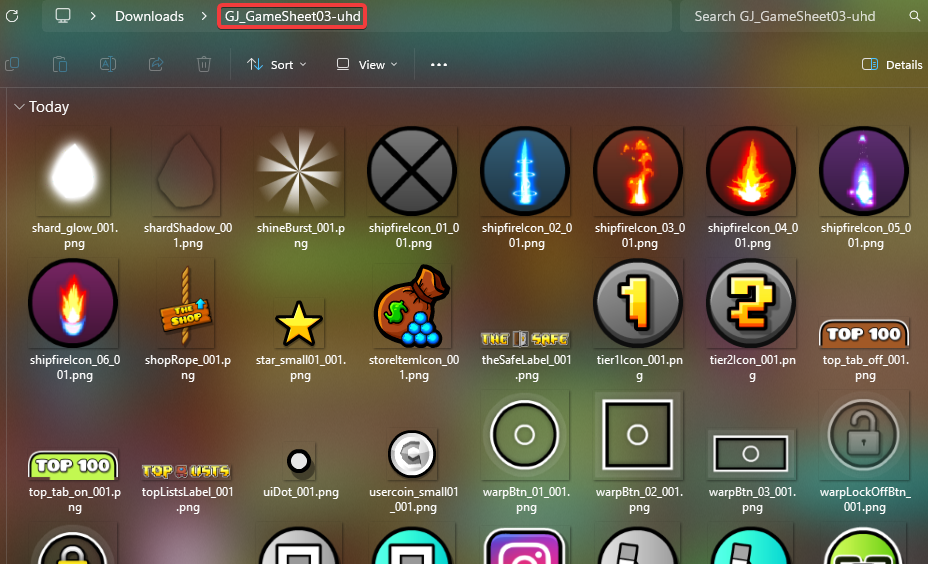
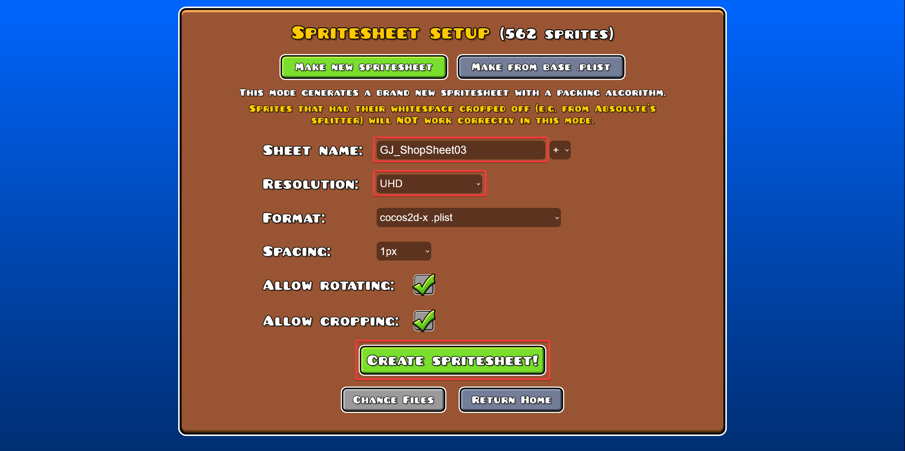

:::caution
Это руководство **НЕ** учит создавать дизайн текстур!
:::

Не знаете, как редактировать текстуры игры для вашего GDPS? Это руководство научит вас этому!

## Требования
Чтобы выполнить остальные шаги этого руководства, убедитесь, что:
- У вас есть графический редактор (например, [Photoshop](https://www.adobe.com/products/photoshop.html), [Pixlr](https://pixlr.com/), [ibisPaint X](https://ibispaint.com/productWin.jsp), [Krita](https://krita.org/), [GIMP](https://www.gimp.org/)...)
- У вас есть базовые текстуры/спрайтшиты, с которыми предстоит работать

## Поиск текстур
Откройте папку `Resources` вашего GDPS и найдите текстуры, которые хотите отредактировать. Вы увидите, что большинство из них находятся внутри одного большого файла вместе со множеством других текстур. Такой файл называется спрайтшитом (spritesheet).

У каждой текстуры в Geometry Dash есть три версии: с окончанием `-uhd` — для высокого качества, с окончанием `-hd` — для среднего качества (и единственная, доступная на мобильных устройствах), и без этих окончаний — для низкого качества.

*Если нужная вам текстура находится не в спрайтшите, вы можете отредактировать её напрямую и пропустить остальную часть руководства (хотя [дополнительный совет в конце](#дополнительный-совет) всё равно может пригодиться!).*

## Извлечение текстур
Чтобы извлечь текстуры из спрайтшита, откройте [GDSplitter от GDColon](https://gdcolon.com/gdsplitter/) и просто перетащите в него PNG- и PLIST-файлы нужного спрайтшита. Подождите несколько секунд, пока он загрузится, и после импорта нажмите «Download all (.zip)».

Распакуйте только что скачанный архив — теперь вы можете свободно изменять нужные текстуры! **Однако обязательно сохраните разрешение и названия в точности прежними.**

## Обратная сборка текстур
Закончив редактирование извлечённого спрайтшита, вернитесь в [GDSplitter от GDColon](https://gdcolon.com/gdsplitter/) и на этот раз нажмите «Merge sprites».

Импортируйте все текстуры из папки с извлечёнными файлами, нажмите «Continue», обязательно введите имя исходного спрайтшита без расширения, выберите подходящее разрешение для ваших текстур и создайте спрайтшит!

## Дополнительный совет
Начинайте с версии высокого качества! Тогда вам останется лишь изменить размер текстуры до нужного разрешения для версий среднего и низкого качества.

---

*Перевела [elixia](https://t.me/elixiadev)*

*Последнее обновление: 27 июля 2026 года*