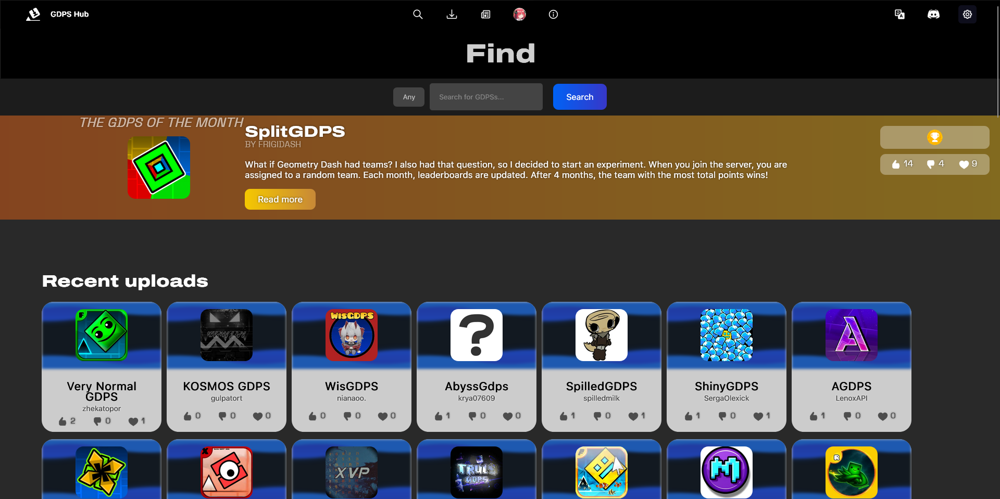

:::caution
Контент перевода на этой странице устарел. Если вы хотите увидеть более актуальную информацию, вы всё ещё можете [ознакомиться с этим руководством на английском языке, нажав здесь](../../../en/gdps/growing-gdps-tips/).
:::

Если вы думаете, что это руководство подскажет быстрый и простой способ без усилий развить ваш GDPS, остановитесь прямо сейчас. Способов развить GDPS много, но они работают, только если вкладывать в них постоянство, время и усилия. Если ваш GDPS — обычный GDPS, как и все остальные, сначала найдите то, что позволит ему выделиться.

## Развитие вашего GDPS
Вот несколько способов, которые помогут вам развивать GDPS дальше и охватить более широкую аудиторию:
- **Социальные сети:** Это, пожалуй, самый популярный вариант, но от этого он не становится проще. Сегодня социальные сети (здесь речь в основном о YouTube, TikTok и Instagram) переполнены контентом по Geometry Dash, поэтому, если вы ищете способ рекламировать там свой GDPS, сначала задайте себе вопросы: «Как мне создать для своего GDPS контент, достаточно уникальный, чтобы люди его заметили? Что нужно делать, чтобы люди продолжали смотреть то, что я публикую?» Поначалу это, конечно, нелегко, но старайтесь придерживаться регулярного графика публикаций и выкладывать видео как можно чаще!
- **Моддинг:** Это один из самых эффективных способов выделить свой GDPS. Добавление в GDPS новых функций, которых раньше почти никто не видел, очень помогает, а даже просто значительное улучшение интерфейса игры привлечёт больше людей на ваш GDPS.
- **GDPS Hub:** Размещение вашего GDPS на [GDPS Hub](https://gdpshub.com/) — как правило, один из основных способов помочь людям найти ваш GDPS в сети (по сути, за пределами Discord). Если ваш GDPS достаточно оригинален, чтобы стать «GDPS месяца», это также может привлечь к нему огромное внимание на этот период!
- **Листы:** Многие ищут GDPS, где можно проходить сложные уровни и соревноваться с другими, потому что на обычных серверах Geometry Dash это невозможно из-за огромного уровня мастерства, необходимого даже для попадания в топ игроков. Наличие листов также помогает другим заметить интересные уровни на вашем GDPS ещё до того, как они присоединятся, а игроки, публикующие на YouTube верификации или новые рекорды, тоже могут пассивно привлекать внимание к вашему GDPS!
- **Конкурсы:** Конкурсы — отличный способ привлечь авторов уровней на ваш GDPS, особенно если за них дают хорошие награды (например, Discord Nitro, карты Steam и т. д.). Конечно, вы не обязаны тратить деньги на награды победителям конкурсов, но обычно это заметно повышает мотивацию и интерес к вашему GDPS.
- **Рекламные каналы:** Хотя это один из самых простых и, пожалуй, наименее эффективных способов рекламы из-за огромного количества людей, которые занимаются этим каждый день, не стоит забывать публиковать рекламу вашего GDPS раз в X периодов — это всегда небольшой плюс!

И помните, развитие вашего GDPS почти всегда занимает **очень-очень много** времени. Не сдавайтесь и всегда старайтесь находить способы развивать его дальше, даже если на это уйдут недели, месяцы или даже годы.

## Удержание аудитории вашего GDPS
Искать способы развития и продвижения вашего GDPS — это здорово, но если не найти способы удержать игроков, они найдут альтернативы, и в итоге проект закроется. Поэтому вот несколько способов поддерживать вовлечённость игроков на вашем GDPS:
- **Ивенты:** Это не обязательно должны быть ивенты на самом GDPS; можно устроить совместную игру на Minecraft-сервере с интересной концепцией или просто поиграть в Among Us в большом голосовом чате — отличная идея, чтобы игроки оставались вовлечёнными в жизнь GDPS.
- **Листы:** Хотя я уже упоминал об этом ранее, листы — отличный способ пассивно привлекать внимание к вашему GDPS. Игроки будут создавать всё более сложные уровни, а другие — пытаться их пройти и подниматься всё выше в рейтингах листов.
- **Новые функции:** Если вы модифицируете свой GDPS, регулярное добавление новых интересных функций и намёки игрокам на предстоящие обновления — отличный способ удержать их на GDPS.
- **Прокачка:** Наличие бота, начисляющего XP, на Discord-сервере вашего GDPS может побуждать игроков продолжать общаться, чтобы получать всё больше XP и подниматься в рейтингах.

И наконец, не забывайте прислушиваться к своему сообществу! Владелец, который активно слушает своё сообщество ради улучшения GDPS, всегда будет восприниматься гораздо лучше, чем тот, кто не слушает вовсе.

*Просмотр статистики тоже очень помогает. Старайтесь регулярно заглядывать на конечную точку статистики `dashboard/api/stats.php` :)*

## Особая благодарность
Хочу поблагодарить [Izumi из GD Lightsync](https://discord.gg/mvbjWdC6cF) и [Cirno из 1.3 GDPS](https://onepointthree.app/) за ответы на мои вопросы при написании этого руководства!

-----

*Перевела [elixia](https://t.me/elixiadev)*

*Последнее обновление: 14 июля 2026 года*