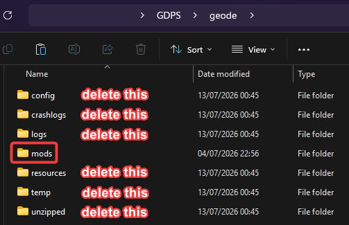
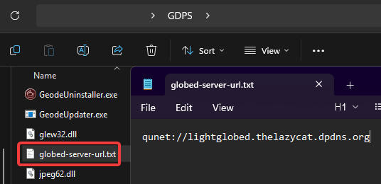
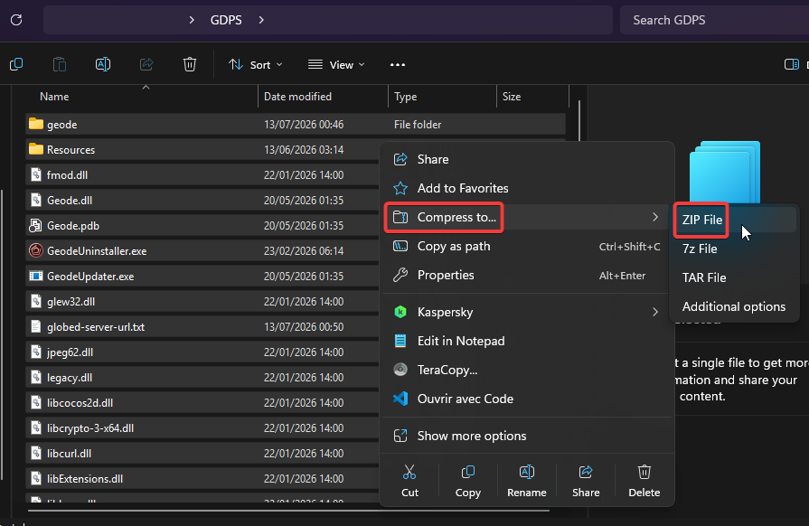

Не знаете, куда загружать файлы GDPS или правильно ли вы их настраиваете? В этом руководстве вы найдёте несколько советов о том, как правильно загружать файлы GDPS!

## Советы по версиям для ПК
При создании архива для ПК-версии вашего GDPS нужно учесть ряд моментов, чтобы не раздувать размер файла. Если вы предустановили Geode, включите в архив только папки `mods` и `resources` внутри папки `geode`.

### Для GDPS с серверами Globed
Если у вас есть собственный сервер Globed, вы можете создать файл `globed-server-url.txt` с URL-адресом вашего сервера Globed в корневой папке вашего GDPS (там, где лежит .exe), чтобы игрокам не приходилось вводить его вручную!

Когда закончите со всем вышеперечисленным, выделите все файлы и папки внутри папки GDPS (**не** саму папку GDPS) и сожмите их в архив.

## Загрузка файлов GDPS
Многим сложно найти хороший бесплатный и постоянный файлообменник, поэтому вот список (от наиболее рекомендуемого к наименее рекомендуемому):
- [Catbox](https://catbox.moe/) (макс. 200 МБ)
- [Pillowcase](https://pillows.su/) (макс. 200 МБ, 500 МБ при входе в аккаунт)
- [Google Drive](https://drive.google.com/) (макс. 15 ГБ, но раскрывает ваше имя/адрес электронной почты. Также посмотрите это: https://sites.google.com/site/gdocs2direct/)
- [Mediafire](https://www.mediafire.com/) (макс. 4 ГБ)
- [MEGA](https://mega.io/) (макс. 20 ГБ)
- [Dropbox](https://www.dropbox.com/) (макс. 2 ГБ)

-----

*Перевела [elixia](https://t.me/elixiadev)*

*Последнее обновление: 13 июля 2026 года*