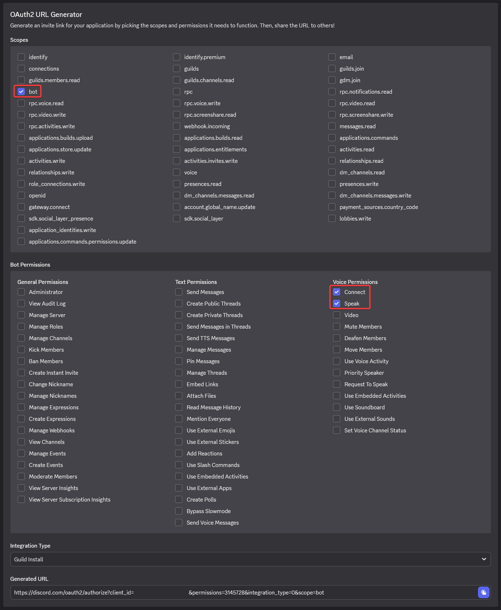
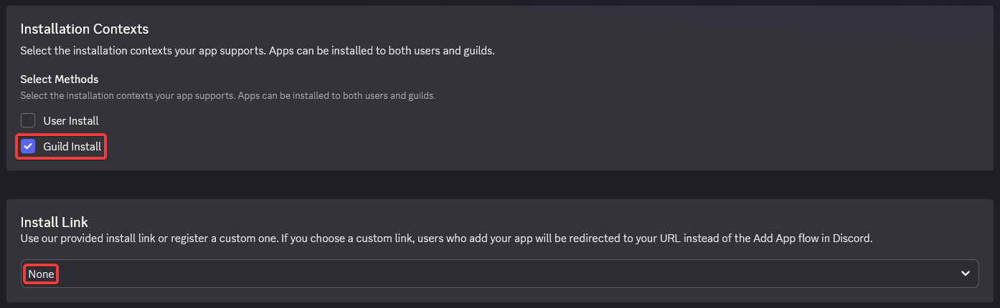
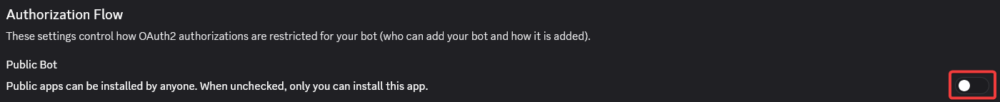

Если вы не знаете, что такое радиобот, — это, по сути, бот в Discord, который круглосуточно проигрывает музыку в указанном вами канале. Это руководство объяснит, как запустить такого бота, который будет проигрывать случайные песни, используемые на вашем GDPS!

## Требования
Чтобы выполнить остальные шаги этого руководства, убедитесь, что:
- У вас установлен [Bun](https://bun.com/)
- У вас есть устройство/сервер, способный работать круглосуточно
- У вас есть полный доступ к SFTP вашего GDPS и к серверу Discord (с правами администратора для добавления бота)
- У вас стабильное интернет-соединение

## Создание бота
Создайте **приложение Discord**, а затем **бота Discord** на [портале разработчиков Discord](https://discord.com/developers/applications), после чего:
- Скопируйте токен бота (он понадобится для файла `.env`)
- В разделе **Генератор URL-адресов OAuth2** выберите `bot`, а затем разрешения `Connect` и `Speak`
- Сгенерируйте ссылку-приглашение и добавьте бота на свой сервер



## Добавление конечной точки бота
Добавьте файл `randomSong.php` в любое место на SFTP вашего GDPS **(не забудьте заменить строку `require "path/to/incl/lib/connection.php";` на правильный путь на вашем сервере)**:
```php
<?php
header("Content-Type: application/json");
header("Access-Control-Allow-Origin: *");
header("Access-Control-Allow-Methods: GET");

require "path/to/incl/lib/connection.php"; // Измените путь в этой строке!

$song = $db->prepare("SELECT * FROM songs WHERE isDisabled = 0 AND download != 'CUSTOMURL' ORDER BY RAND() ASC LIMIT 1");
$song->execute();
$song = $song->fetch();

$data = [
    "ID" => $song["ID"],
    "author" => $song["authorName"],
    "name" => $song["name"],
    "download" => $song["download"],
    "reuploadID" => $song["reuploadID"],
    "reuploadTime" => $song["reuploadTime"]
];

exit(json_encode([
    "dashboard" => true,
    "success" => true,
    "song" => $data
]));
?>
```
*Файл должен быть общедоступен (через HTTP/HTTPS).*

**Пример:** `https://m336test.ps.fhgdps.com/randomSong.php` (с `require "incl/lib/connection.php";`)

## Загрузка и запуск бота
1. [Скачайте репозиторий](https://github.com/M336G/gdps-radio-bot/archive/refs/heads/main.zip) на устройство или сервер, способный работать круглосуточно, либо клонируйте его командой: `git clone https://github.com/M336G/gdps-radio-bot.git`
2. Затем в его (распакованной) папке установите зависимости командой `bun install` и заполните файл `.env` в соответствии с вашими потребностями (пример смотрите в [.env.example](https://github.com/M336G/gdps-radio-bot/blob/main/.env.example))
3. Наконец, запустите бота командой `bun run start`!

**Убедитесь, что:**
- Бот онлайн в Discord
- Он проигрывает песни в нужном канале

## Запрет на приглашение бота другими пользователями
Это совершенно необязательно, так как бот всё равно не будет работать на других серверах, но это всегда приятный завершающий шаг, чтобы поставить точку во всём этом!

На [портале разработчиков Discord](https://discord.com/developers/applications) установите:
- **Контекст установки** — только `Guild Install` (в категории «Установка»)
- **Ссылка для установки** — `None` (также в категории «Установка»)
- **Публичный бот** — `false` (в категории «Бот»)





-----

*Перевела [elixia](https://t.me/elixiadev)*

*Последнее обновление: 16 июля 2026 года*