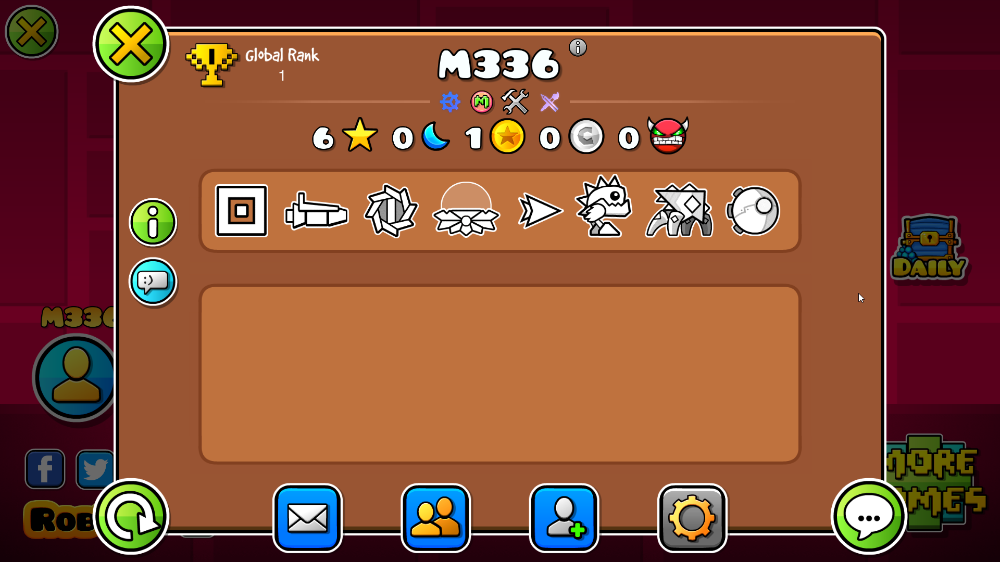
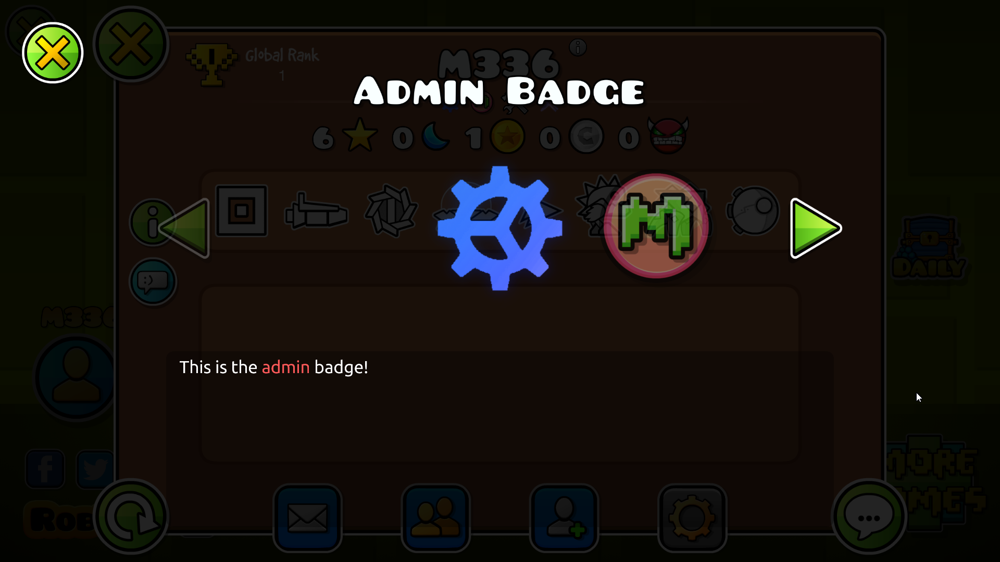
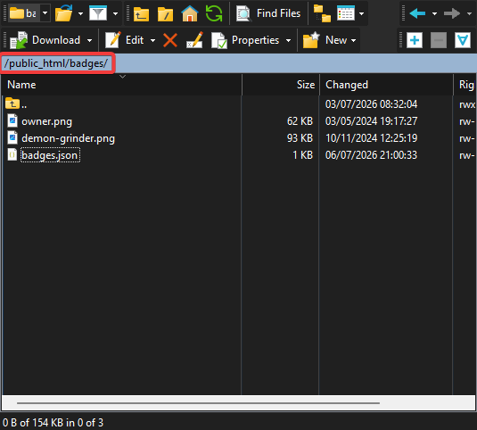
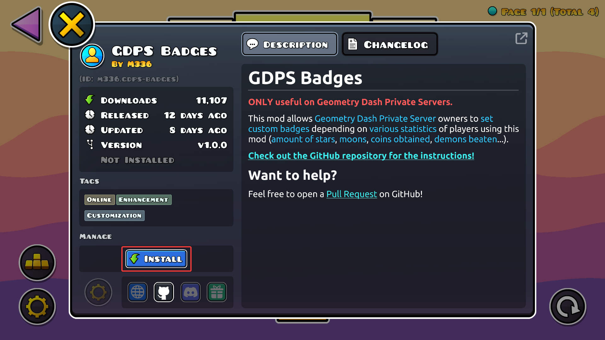

:::caution
Зміст перекладу на цій сторінці застарів. Якщо ви бажаєте побачити більш актуальну інформацію, ви все ще можете [ознайомитися з цим посібником англійською мовою, натиснувши тут](../../../en/gdps/adding-custom-badges/).
:::

Цей посібник покаже, як додати власні бейджі вашим гравцям у грі за допомогою [мода GDPS Badges](https://geode-sdk.org/mods/m336.gdps-badges)!





*Цей посібник здебільшого призначений для власників/адміністраторів GDPS; якщо ви звичайний гравець, зачекайте, поки ваш GDPS оголосить про сумісність із цим модом, щоб побачити власні бейджі в грі.*

## Вимоги
Щоб виконати решту кроків цього посібника, переконайтеся, що:
- Ви маєте повний доступ до SFTP вашого GDPS
- Ви вже створили кілька власних бейджів, які хочете додати (зрештою, у цьому й суть посібника… чи не так? *Рекомендована роздільна здатність — 92x92, мод приймає лише формат PNG.*)

## Створення badges.json
У SFTP перейдіть до публічного кореневого каталогу вашого GDPS (зазвичай `public_html`) і створіть нову папку `badges`; саме тут ви визначатимете властивості бейджів і додаватимете їхні текстури.

У папці `badges` створіть файл `badges.json` і заповніть його за цим прикладом:
```json
[
    {
        "id": "owner",
        "name": "Owner",
        "description": "Це <cr>власник</c> цього GDPS!",
        "requirements": {
            "players": [ 72 ]
        }
    },
    {
        "id": "demon-grinder",
        "name": "Demon Grinder",
        "description": "Цей гравець пройшов понад <cr>2 500</c> рівнів складності Demon!",
        "requirements": {
            "minDemons": 2500,
            "maxDemons": 9999
        }
    }
]
```

### Можливі вимоги
| Параметр | Опис | Приклад |
| --- | --- | --- |
| `players` | Білий список ID акаунтів, які можуть мати бейдж | `"players": [ 72, 73, 74 ]` |
| `modBadge` | Додає власний бейдж за наявності одного з бейджів модератора. Може бути `leaderboard`, `elder` або `regular` | `"modBadge": "elder"` |
| `minRank` | Мінімальний глобальний ранг, необхідний для отримання бейджа | `"minRank": 1` |
| `maxRank` | Максимальний глобальний ранг, допустимий для отримання бейджа | `"maxRank": 100` |
| `minStars` | Мінімальна кількість зірок, необхідна для отримання бейджа | `"minStars": 1000` |
| `maxStars` | Максимальна кількість зірок, допустима для отримання бейджа | `"maxStars": 5000` |
| `minMoons` | Мінімальна кількість місяців, необхідна для отримання бейджа | `"minMoons": 500` |
| `maxMoons` | Максимальна кількість місяців, допустима для отримання бейджа | `"maxMoons": 2000` |
| `minGoldCoins` | Мінімальна кількість секретних монет, необхідна для отримання бейджа | `"minGoldCoins": 50` |
| `maxGoldCoins` | Максимальна кількість секретних монет, допустима для отримання бейджа | `"maxGoldCoins": 164` |
| `minSilverCoins` | Мінімальна кількість користувацьких монет, необхідна для отримання бейджа | `"minSilverCoins": 100` |
| `maxSilverCoins` | Максимальна кількість користувацьких монет, допустима для отримання бейджа | `"maxSilverCoins": 500` |
| `minDemons` | Мінімальна кількість пройдених демонів, необхідна для отримання бейджа | `"minDemons": 10` |
| `maxDemons` | Максимальна кількість пройдених демонів, допустима для отримання бейджа | `"maxDemons": 100` |

## Додавання іконок бейджів
Тепер просто перетягніть наявні текстури до папки `badges`.
Переконайтеся, що назва файлу збігається з ID, який ви вказали для відповідного бейджа в `badges.json`!

Наприклад, якщо ви хочете додати текстуру для бейджа Demon Grinder, наведеного вище, перетягніть файл із назвою `demon-grinder.png`.


## Поширення мода
Тепер просто повідомте гравцям, що ваш GDPS сумісний із модом:
- Або [завантаживши його вручну](https://geode-sdk.org/mods/m336.gdps-badges) і помістивши в папку модів Geode,
- Або, просто в грі, завантаживши його **з індексу**, як показано нижче:


-----

*Переклала [elixia](https://t.me/elixiadev)*

*Останнє оновлення: 15 липня 2026 року*