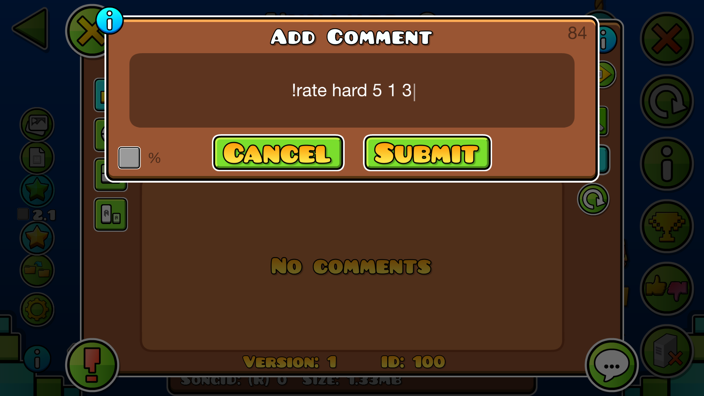
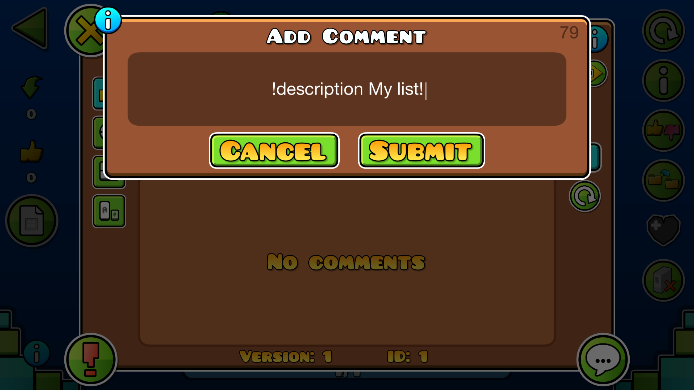
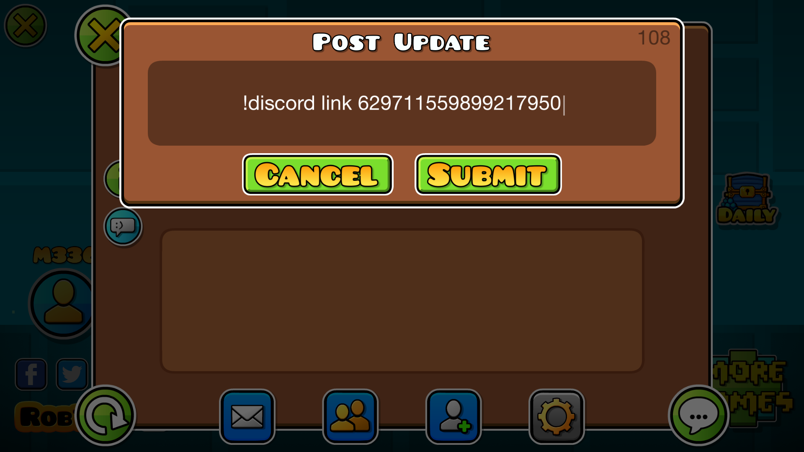

Це всі команди, доступні на GDPS за допомогою [форку GMDprivateServer від MegaSa1nt](https://github.com/MegaSa1nt/GMDprivateServer/tree/master)!

*Деякі команди мають необов’язкові аргументи, які для простоти тут не перелічені.*

## Команди рівнів
Ці команди можна використовувати в розділі коментарів під рівнем!

### Оцінка
| Команда | Дозвіл | Опис |
| --- | --- | --- |
| `!rate` / `!r <складність> <зірки> <монетки> <feature>` | `commandRate` | Оцінює рівень. `складність`: `auto`, `easy`, `normal`, `hard`, `harder`, `insane` або `demon`. `монетки`: `1` = увімк., `0` = вимк. `feature`: `0` = лише оцінка, `1` = featured, `2` = epic, `3` = legendary, `4` = mythic. |
| `!unrate` / `!unr` | `commandRate` | Повністю знімає оцінку з рівня. |
| `!send <складність> <зірки> <feature>` | `actionSuggestRating` | Надсилає рівень на оцінку. `складність`: `auto`, `easy`, `normal`, `hard`, `harder`, `insane` або `demon`. `feature`: `0` = лише оцінка, `1` = featured, `2` = epic, `3` = legendary, `4` = mythic. |
| `!unsend` | `actionSuggestRating` | Повністю скасовує надсилання рівня. |

### Feature
| Команда | Дозвіл | Опис |
| --- | --- | --- |
| `!feature` / `!f` | `commandFeature` | Робить рівень Featured. |
| `!epic` | `commandEpic` | Робить рівень епічним. |
| `!legendary` | `commandEpic` | Робить рівень легендарним. |
| `!mythic` | `commandEpic` | Робить рівень міфічним. |
| `!unfeature` | `commandFeature` | Знімає статус Featured. |
| `!unepic` | `commandEpic` | Знімає епічний статус. |
| `!unlegendary` | `commandEpic` | Знімає легендарний статус. |
| `!unmythic` | `commandEpic` | Знімає міфічний статус. |

### Daily
| Команда | Дозвіл | Опис |
| --- | --- | --- |
| `!daily` / `!da` | `commandDaily` | Встановлює рівень як наступний щоденний. |
| `!weekly` / `!w` | `commandWeekly` | Встановлює рівень як наступний щотижневий. |
| `!event` / `!ev <minutes> <reward ID> <amount>` | `commandEvent` | Встановлює рівень як наступний івент-рівень на вказаний час. Щоб додати кілька нагород: `!event <minutes> <reward ID> <amount> <reward ID> <amount>...` [Ідентифікатори нагород](#нагороди). |

### Монетки та бали творця
| Команда | Дозвіл | Опис |
| --- | --- | --- |
| `!verifycoins` / `!vc` | `commandVerify` | Верифікує монетки рівня. |
| `!unverifycoins` | `commandVerify` | Знімає верифікацію з монеток рівня. |
| `!sharecp <username>` | `commandSharecpOwn` / `commandSharecpAll` | Ділиться балами творця за рівень з іншим користувачем. |

### Керування
| Команда | Дозвіл | Опис |
| --- | --- | --- |
| `!setacc` / `!sa <username/account ID>` | `commandSetacc` | Змінює творця рівня. |
| `!lockUpdating` / `!lu` | `commandLockUpdating` | Забороняє творцю оновлювати рівень. |
| `!unlockUpdating` / `!unlu` | `commandLockUpdating` | Знову дозволяє творцю оновлювати рівень. |
| `!rename` / `!re <name>` | `commandRenameOwn` / `commandRenameAll` | Перейменовує рівень. |
| `!description` / `!desc <description>` | `commandDescriptionOwn` / `commandDescriptionAll` | Змінює опис рівня. |
| `!song` / `!s <song ID>` | `commandSongOwn` / `commandSongAll` | Змінює пісню рівня. |
| `!public` / `!pub` | `commandPublicOwn` / `commandPublicAll` | Робить рівень публічним. |
| `!unlist` | `commandUnlistOwn` / `commandUnlistAll` | Робить рівень прихованим. |
| `!ldm` | `commandLdmOwn` / `commandLdmAll` | Вмикає LDM на рівні. |
| `!unldm` | `commandLdmOwn` / `commandLdmAll` | Вимикає LDM на рівні. |
| `!password` / `!pass` / `!p <6 цифр>` | `commandPassOwn` / `commandPassAll` | Встановлює пароль для копіювання рівня. Надішліть `000000`, щоб прибрати його. |
| `!lockComments` / `!lc` | `commandLockCommentsOwn` / `commandLockCommentsAll` | Закриває коментарі під рівнем. |
| `!unlockComments` / `!unlc` | `commandLockCommentsOwn` / `commandLockCommentsAll` | Відкриває коментарі під рівнем. |
| `!delete` / `!delet` / `!d` | `commandDelete` | Видаляє рівень. |

## Команди списків
Ці команди можна використовувати в розділі коментарів під списком!

### Оцінка та Feature
| Команда | Дозвіл | Опис |
| --- | --- | --- |
| `!rate` / `!r <нагорода> <складність> <featured> <кількість>` | `commandRate` | Оцінює список. `складність`: `auto`, `easy`, `normal`, `hard`, `harder`, `insane` або `demon`. `featured`: `0` = лише оцінка, `1` = featured. `кількість`: скільки рівнів потрібно пройти для отримання нагороди. Якщо є лише `actionSuggestRating`, команда натомість пропонує список на оцінку. [Ідентифікатори нагород](#нагороди). |
| `!feature` / `!f` | `commandFeature` | Робить список Featured. |
| `!unfeature` | `commandFeature` | Знімає статус Featured. |

### Керування
| Команда | Дозвіл | Опис |
| --- | --- | --- |
| `!rename` / `!re <name>` | `commandRenameOwn` / `commandRenameAll` | Перейменовує список. |
| `!description` / `!desc <description>` | `commandDescriptionOwn` / `commandDescriptionAll` | Змінює опис списку. |
| `!setacc` / `!sa <username/account ID>` | `commandSetacc` | Змінює творця списку. |
| `!unlist` | `commandUnlistOwn` / `commandUnlistAll` | Робить список прихованим. Використовуйте `!unlist 0`, щоб зробити його публічним, і `!unlist 1` — лише для друзів. |
| `!lockComments` / `!lc` | `commandLockCommentsOwn` / `commandLockCommentsAll` | Закриває коментарі під списком. |
| `!unlockComments` / `!unlc` | `commandLockCommentsOwn` / `commandLockCommentsAll` | Відкриває коментарі під списком. |
| `!delete` / `!d` | `commandDelete` | Видаляє список. |

## Команди профілю
Ці команди можна використовувати в розділі коментарів під вашим профілем! Працюють лише в тому випадку, якщо GDPS підтримує прив’язку Discord-акаунтів.

| Команда | Опис |
| --- | --- |
| `!discord link <discord ID>` | Починає процес прив’язки та надсилає 4-значний код у приватні повідомлення. |
| `!discord accept <code>` | Прив’язує ваш профіль до Discord-акаунта, якщо код правильний. |
| `!discord unlink` | Відв’язує ваш профіль від Discord-акаунта. |

## Нагороди
Це ID для кожного типу нагород.

### Shard-нагороди
| ID | Нагорода |
| --- | --- |
| **1** | Fire Shard |
| **2** | Ice Shard |
| **3** | Poison Shard |
| **4** | Shadow Shard |
| **5** | Lava Shard |
| **10** | Earth Shard |
| **11** | Blood Shard |
| **12** | Metal Shard |
| **13** | Light Shard |
| **14** | Soul Shard |

### Icon-нагороди
| ID | Нагорода |
| --- | --- |
| **1001** | Cube |
| **1002** | Color 1 |
| **1003** | Color 2 |
| **1004** | Ship |
| **1005** | Ball |
| **1006** | UFO |
| **1007** | Wave (Dart) |
| **1008** | Robot |
| **1009** | Spider |
| **1010** | Trail |
| **1011** | Death Effect |
| **1013** | Swing |
| **1014** | Jetpack |
| **1015** | Ship fire |

### Інші нагороди
| ID | Нагорода |
| --- | --- |
| **6** | Demon Key |
| **7** | Orbs |
| **8** | Diamond |
| **15** | Gold Key |
| **1012** | Items (keys, paths, gems, music hack, etc.) |

-----

*Переклала [elixia](https://t.me/elixiadev)*

*Останнє оновлення: 14 липня 2026 року*