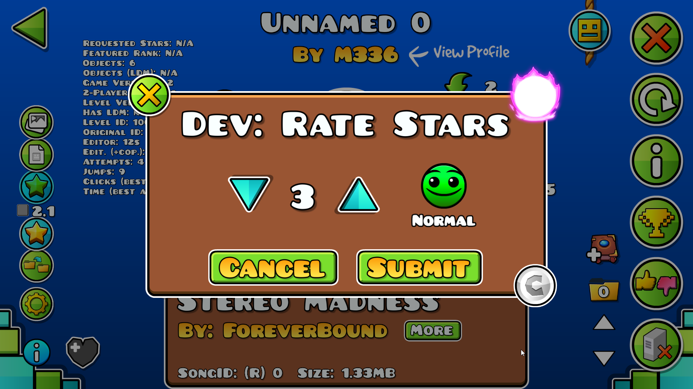
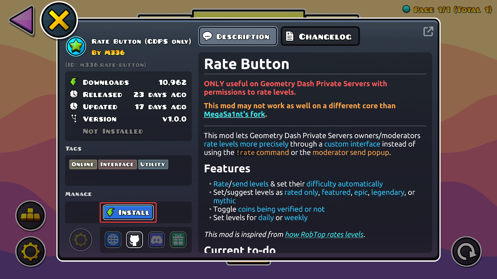
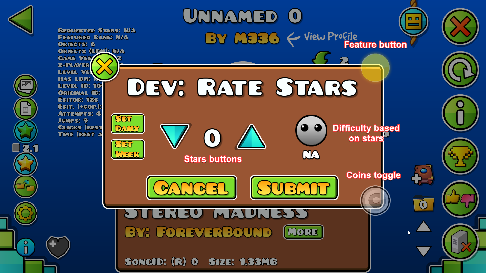
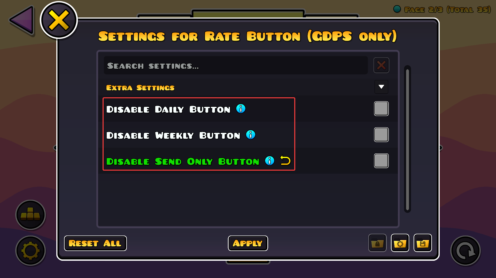

Цей посібник покаже, як отримати інтерфейс, [який використовує RobTop](https://www.youtube.com/watch?v=_wmWuymEZDs), для оцінювання рівнів на GDPS за допомогою мода для Geode!

## Вступ
Цей мод не обмежується лише оцінюванням рівнів на GDPS; він також створений для того, щоб:
- Оцінювати рівні, не з’ясовуючи, які саме права для цього потрібні; усередині він використовує команди `!rate` та `!unrate`, але додає до них зручний інтерфейс!
- Працювати без бейджа модератора та без натискання кнопки «Req.» в налаштуваннях гри. Вам потрібне лише [необхідне право](#вимоги). *Це дозволяє оцінювати рівні, навіть якщо у вас є бейдж Leaderboard-модератора!*
- Бути максимально інтуїтивним: призначення кожної кнопки зрозуміле, без прихованих значень

## Вимоги
Щоб виконати решту кроків цього посібника, переконайтеся, що:
- Ви використовуєте GDPS (*[GDPS Switcher](https://geode-sdk.org/mods/km7dev.gdps-switcher) також підійде*)
- У вас увімкнено право `commandRate` *(так... і це все)*
- Ви використовуєте [Geode v5.7.1 або новішу версію](https://geode-sdk.org/install)

## Встановлення мода
Встановити мод дуже просто!
- Або [завантажте його вручну](https://geode-sdk.org/mods/m336.rate-button) і помістіть у папку модів Geode,
- Або, просто в грі, завантажте його **з індексу** як показано нижче:

## Використання мода
Після того як ви завантажите мод і перезапустите гру, при натисканні на рівень ви помітите нову синю кнопку. Вона відкриває інтерфейс для оцінювання рівнів!
- Натискання на стрілки **вниз** і **вгору** **зменшує** або **збільшує** **кількість зірок**, яка буде присвоєна рівню (складність встановлюється автоматично на її основі)
- Натискання на **кнопку feature** дозволяє вибрати, чи буде рівень просто **оцінений**, **featured**, **епічним**, **легендарним** чи **міфічним**
- Натискання на **кнопку монет** вмикає або вимикає **верифікацію** **монет**

*Якщо встановити 0 зірок і натиснути Submit, оцінку з рівня буде повністю знято, навіть якщо ви вибрали статус feature або ввімкнули монети.*

## Додаткові функції
У налаштуваннях мода також можна вмикати та вимикати такі додаткові кнопки:
- Кнопка **Set Daily** дозволяє встановити рівень як наступний щоденний (потрібне право `commandDaily`)
- Кнопка **Set Week** дозволяє встановити рівень як наступний щотижневий (потрібне право `commandWeekly`)
- Кнопка **Send Only** дозволяє запропонувати рівень замість того, щоб оцінювати його (потрібне право `actionSuggestRating`)

-----

*Переклала [elixia](https://t.me/elixiadev)*

*Останнє оновлення: 12 липня 2026 року*