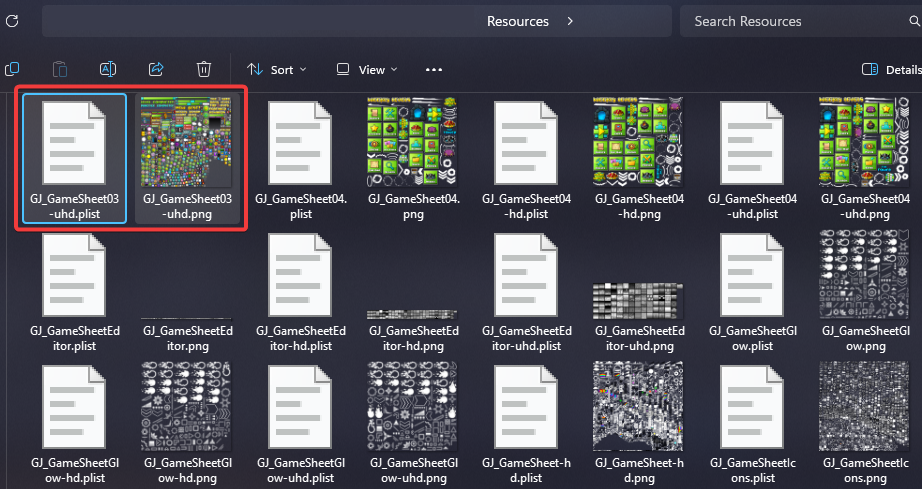
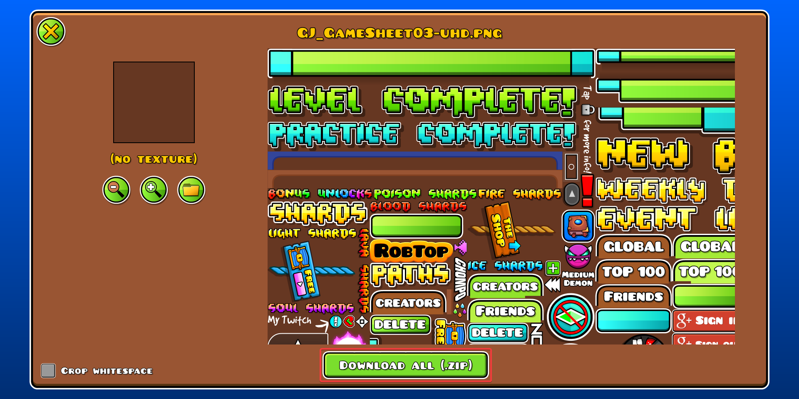
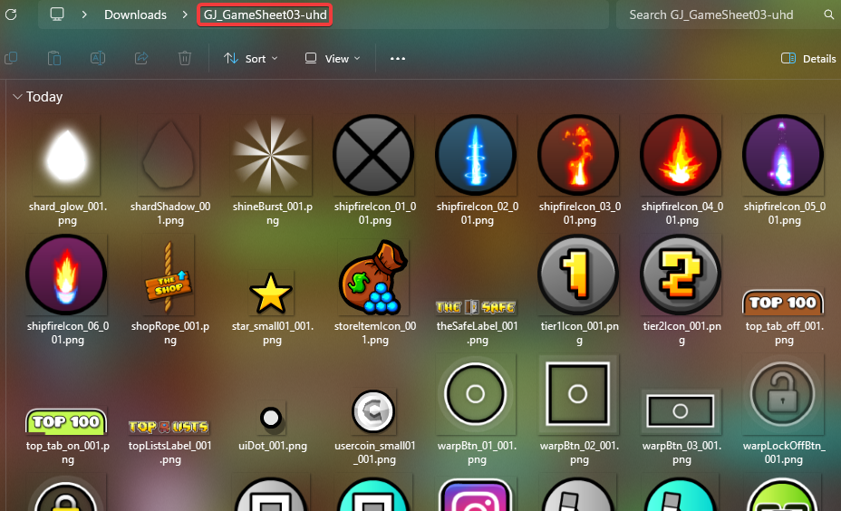
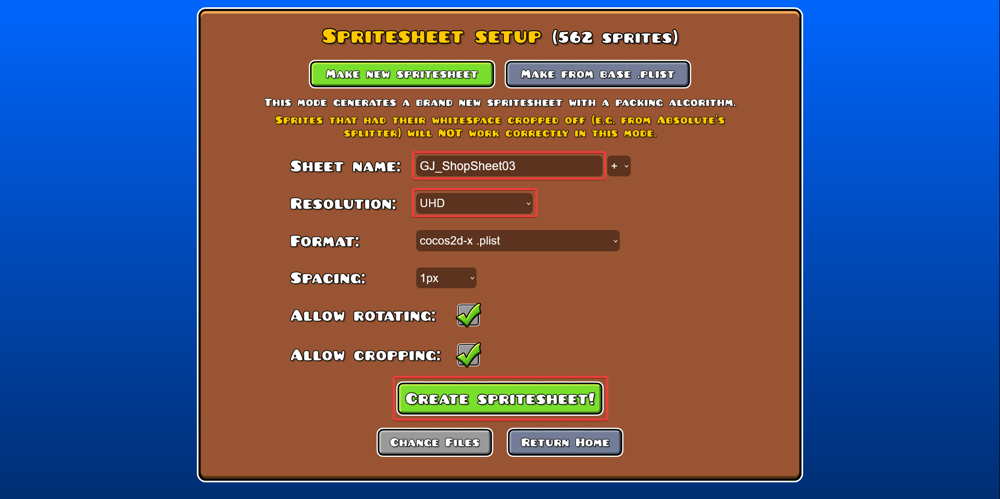

:::caution
Цей посібник **НЕ** навчає створювати дизайн текстур!
:::

Не знаєте, як редагувати текстури гри для вашого GDPS? Цей посібник навчить вас цього!

## Вимоги
Щоб виконати решту кроків цього посібника, переконайтеся, що:
- У вас є графічний редактор (наприклад, [Photoshop](https://www.adobe.com/products/photoshop.html), [Pixlr](https://pixlr.com/), [ibisPaint X](https://ibispaint.com/productWin.jsp), [Krita](https://krita.org/), [GIMP](https://www.gimp.org/)...)
- У вас є базові текстури/спрайтшити, з якими належить працювати

## Пошук текстур
Відкрийте папку `Resources` вашого GDPS і знайдіть текстури, які хочете відредагувати. Ви побачите, що більшість із них міститься в одному великому файлі разом із безліччю інших текстур. Такий файл називається спрайтшитом (spritesheet).

Кожна текстура в Geometry Dash має три версії: із закінченням `-uhd` — для високої якості, із закінченням `-hd` — для середньої якості (і єдина, доступна на мобільних пристроях), та без цих закінчень — для низької якості.

*Якщо потрібна вам текстура лежить не в спрайтшиті, ви можете відредагувати її напряму й пропустити решту посібника (хоча [додаткова порада в кінці](#додаткова-порада) все одно може стати в пригоді!).*

## Видобування текстур
Щоб видобути текстури зі спрайтшита, відкрийте [GDSplitter від GDColon](https://gdcolon.com/gdsplitter/) і просто перетягніть до нього PNG- та PLIST-файли потрібного спрайтшита. Зачекайте кілька секунд, поки він завантажиться, і після імпорту натисніть «Download all (.zip)».

Розпакуйте щойно завантажений архів — тепер ви можете вільно змінювати потрібні текстури! **Однак обов’язково збережіть роздільну здатність і назви точно такими самими.**

## Зворотне збирання текстур
Закінчивши редагування видобутого спрайтшита, поверніться до [GDSplitter від GDColon](https://gdcolon.com/gdsplitter/) і цього разу натисніть «Merge sprites».

Імпортуйте всі текстури з папки з видобутими файлами, натисніть «Continue», обов’язково введіть ім’я вихідного спрайтшита без розширення, виберіть відповідну роздільну здатність для ваших текстур і створіть спрайтшит!

## Додаткова порада
Починайте з версії високої якості! Тоді вам залишиться лише змінити розмір текстури до потрібної роздільної здатності для версій середньої та низької якості.

---

*Переклала [elixia](https://t.me/elixiadev)*

*Останнє оновлення: 27 липня 2026 року*