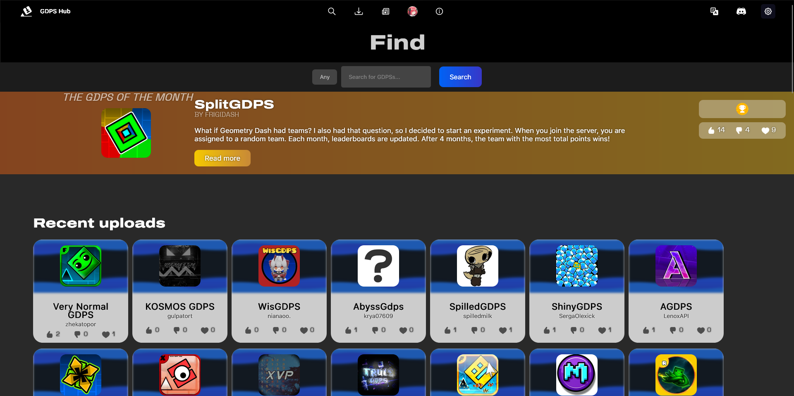

Якщо ви думаєте, що цей посібник підкаже швидкий і простий спосіб без зусиль розвинути ваш GDPS, зупиніться просто зараз. Способів розвинути GDPS багато, але вони працюють, лише якщо вкладати в них сталість, час і зусилля. Якщо ваш GDPS — звичайний GDPS, як і всі інші, спочатку знайдіть те, що дозволить йому виділитися.

## Розвиток вашого GDPS
Ось кілька способів, які допоможуть вам розвивати GDPS далі та охопити ширшу аудиторію:
- **Соціальні мережі:** Це, мабуть, найпопулярніший варіант, але від цього він не стає простішим. Сьогодні соціальні мережі (тут ідеться переважно про YouTube, TikTok та Instagram) переповнені контентом із Geometry Dash, тому, якщо ви шукаєте спосіб рекламувати там свій GDPS, спочатку поставте собі запитання: «Як мені створити для свого GDPS контент, достатньо унікальний, щоб люди його помітили? Що потрібно робити, щоб люди продовжували дивитися те, що я публікую?» Спочатку це, звісно, нелегко, але намагайтеся дотримуватися регулярного графіка публікацій і викладати відео якомога частіше!
- **Моддинг:** Це один із найефективніших способів виділити свій GDPS. Додавання до GDPS нових функцій, яких раніше майже ніхто не бачив, дуже допомагає, а навіть просто значне покращення інтерфейсу гри приверне більше людей на ваш GDPS.
- **GDPS Hub:** Розміщення вашого GDPS на [GDPS Hub](https://gdpshub.com/) — як правило, один із основних способів допомогти людям знайти ваш GDPS в Інтернеті (по суті, поза межами Discord). Якщо ваш GDPS достатньо оригінальний, щоб стати «GDPS місяця», це також може привернути до нього величезну увагу на цей період!
- **Списки:** Багато хто шукає GDPS, де можна проходити складні рівні та змагатися з іншими, адже на звичайних серверах Geometry Dash це неможливо через надзвичайно високий рівень майстерності, потрібний навіть для потрапляння до топу гравців. Наявність списків також допомагає іншим помітити цікаві рівні на вашому GDPS ще до того, як вони приєднаються, а гравці, які публікують на YouTube верифікації або нові рекорди, теж можуть пасивно привертати увагу до вашого GDPS!
- **Конкурси:** Конкурси — чудовий спосіб залучити творців рівнів до вашого GDPS, особливо якщо за них дають гарні нагороди (як-от Discord Nitro, картки Steam тощо). Звісно, ви не зобов’язані витрачати гроші на нагороди переможцям конкурсів, але зазвичай це помітно підвищує їхню мотивацію та інтерес до вашого GDPS.
- **Рекламні канали:** Хоча це один із найпростіших і, мабуть, найменш ефективних способів реклами через величезну кількість людей, які роблять це щодня, не варто забувати публікувати рекламу вашого GDPS раз на X періодів — це завжди невеликий плюс!

І пам’ятайте: розвиток вашого GDPS майже завжди займає **дуже-дуже багато** часу. Не здавайтеся і завжди намагайтеся знаходити способи розвивати його далі, навіть якщо на це підуть тижні, місяці чи навіть роки.

## Утримання аудиторії вашого GDPS
Шукати способи розвитку і просування вашого GDPS — це чудово, але якщо не знайти способів утримати гравців, вони знайдуть альтернативи, і зрештою проєкт закриється. Тому ось кілька способів підтримувати залученість гравців на вашому GDPS:
- **Події:** Це не обов’язково мають бути події на самому GDPS; можна влаштувати спільну гру на Minecraft-сервері з цікавою концепцією або просто пограти в Among Us у великому голосовому чаті — чудова ідея, щоб гравці залишалися залученими до життя GDPS.
- **Списки:** Хоча я вже згадував про це раніше, списки — чудовий спосіб пасивно привертати увагу до вашого GDPS. Гравці створюватимуть дедалі складніші рівні, а інші — намагатимуться їх пройти й підніматися дедалі вище в рейтингах списків.
- **Нові функції:** Якщо ви модифікуєте свій GDPS, регулярне додавання нових цікавих функцій і натяки гравцям на майбутні оновлення — чудовий спосіб утримати їх на GDPS.
- **Прокачування:** Наявність бота, що нараховує XP, на Discord-сервері вашого GDPS може спонукати гравців продовжувати спілкуватися, щоб отримувати дедалі більше XP і підніматися в рейтингах.

І нарешті, не забувайте дослухатися до своєї спільноти! Власник, який активно слухає свою спільноту заради покращення GDPS, завжди сприйматиметься набагато краще, ніж той, хто не слухає взагалі.

*Перегляд статистики теж дуже допомагає. Намагайтеся регулярно заглядати на кінцеву точку статистики `dashboard/api/stats.php` :)*

## Особлива подяка
Хочу подякувати [Izumi з GD Lightsync](https://discord.gg/mvbjWdC6cF) та [Cirno з 1.3 GDPS](https://onepointthree.app/) за відповіді на мої запитання під час написання цього посібника!

-----

*Переклала [elixia](https://t.me/elixiadev)*

*Останнє оновлення: 14 липня 2026 року*