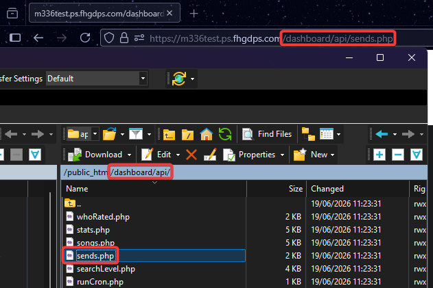

:::caution
Зміст перекладу на цій сторінці застарів. Якщо ви бажаєте побачити більш актуальну інформацію, ви все ще можете [ознайомитися з цим посібником англійською мовою, натиснувши тут](../../../en/gdps/levelinfo-sent-indicator/).
:::

Індикатор надсилання в [Level Info](https://geode-sdk.org/mods/m336.levelinfo) не працює на GDPS «з коробки», тому потребує ручного налаштування; у цьому посібнику розповідається, як його налаштувати!

*Наразі цей метод «частково» підтримується Level Info. Рівні, які не надіслано, відображатимуться як «Failed», а надіслані — як «Sent».*

## Знайдіть кінцеву точку надсилання вашого GDPS
Спочатку знайдіть повну URL-адресу кінцевої точки `sends.php`. Зазвичай вона розташована в папці `dashboard/api`

**Приклад:** `https://m336test.ps.fhgdps.com/dashboard/api/sends.php`

## Налаштування користувацької кінцевої точки надсилання
Потім перейдіть до налаштувань Level Info та знайдіть пункт «Custom Sends Endpoint». Вставте знайдену URL-адресу та не забудьте додати `?level=` у кінці

**Приклад:** `https://m336test.ps.fhgdps.com/dashboard/api/sends.php?level=`

## Застосування налаштувань
Збережіть/застосуйте налаштування. Індикатор надсилання тепер має знову працювати!

-----

*Переклала [elixia](https://t.me/elixiadev)*

*Останнє оновлення: 14 липня 2026 року*