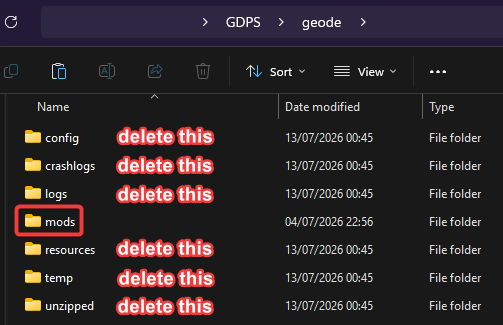
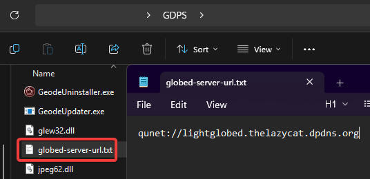
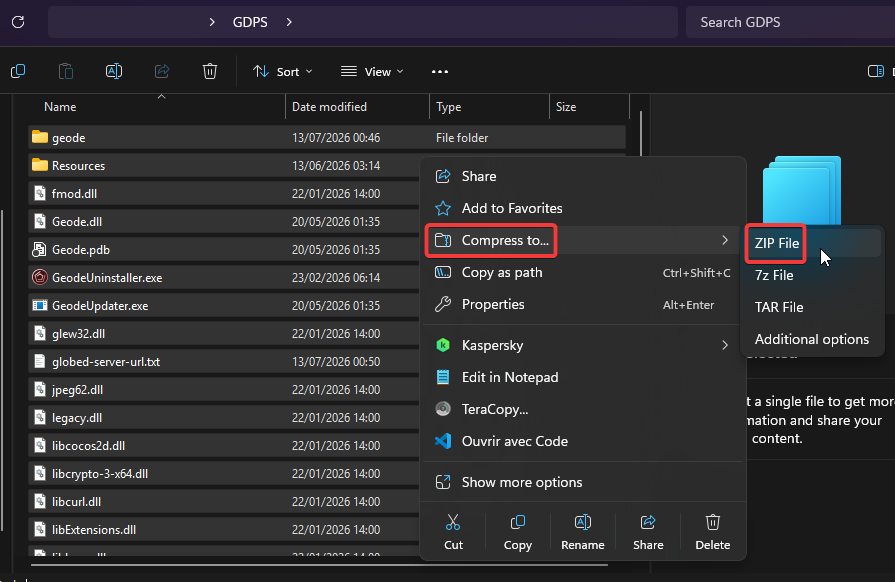

Не знаєте, куди завантажувати файли GDPS або чи правильно ви їх налаштовуєте? У цьому посібнику ви знайдете кілька порад щодо того, як правильно завантажувати файли GDPS!

## Поради щодо версій для ПК
Під час створення архіву для ПК-версії вашого GDPS слід врахувати низку моментів, щоб не збільшувати розмір файлу без потреби. Якщо ви попередньо встановили Geode, включіть до архіву лише папки `mods` та `resources` усередині папки `geode`.

### Для GDPS із серверами Globed
Якщо у вас є власний сервер Globed, ви можете створити файл `globed-server-url.txt` з URL-адресою вашого сервера Globed у кореневій папці вашого GDPS (там, де лежить .exe), щоб гравцям не доводилося вводити її вручну!

Коли завершите всі наведені вище кроки, виберіть усі файли та папки всередині папки GDPS (**не** саму папку GDPS) і стисніть їх в архів.

## Завантаження файлів GDPS
Багатьом складно знайти хороший безкоштовний і постійний файлообмінник, тому ось список (від найбільш рекомендованого до найменш рекомендованого):
- [Catbox](https://catbox.moe/) (макс. 200 МБ)
- [Pillowcase](https://pillows.su/) (макс. 200 МБ, 500 МБ після входу в акаунт)
- [Google Drive](https://drive.google.com/) (макс. 15 ГБ, але розкриває ваше ім’я/адресу електронної пошти. Також подивіться це: https://sites.google.com/site/gdocs2direct/)
- [Mediafire](https://www.mediafire.com/) (макс. 4 ГБ)
- [MEGA](https://mega.io/) (макс. 20 ГБ)
- [Dropbox](https://www.dropbox.com/) (макс. 2 ГБ)

-----

*Переклала [elixia](https://t.me/elixiadev)*

*Останнє оновлення: 13 липня 2026 року*