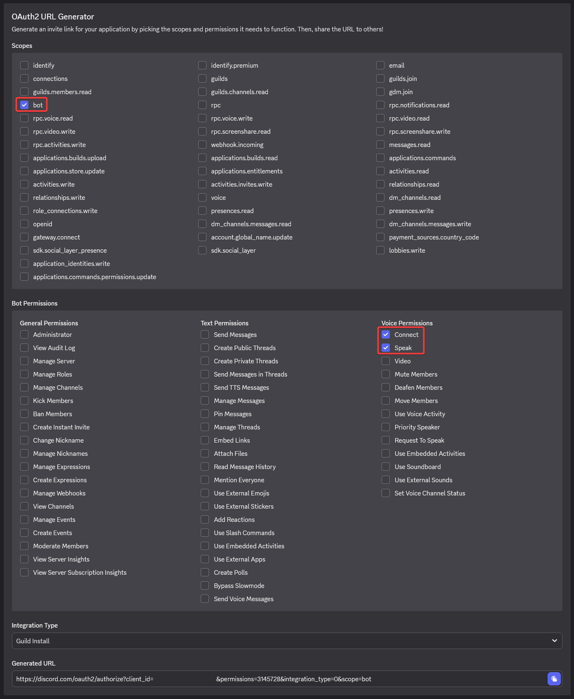
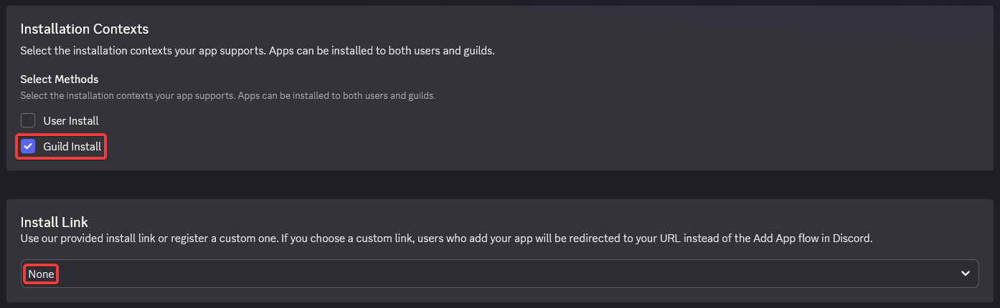
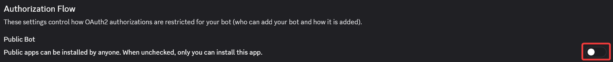

:::caution
Зміст перекладу на цій сторінці застарів. Якщо ви бажаєте побачити більш актуальну інформацію, ви все ще можете [ознайомитися з цим посібником англійською мовою, натиснувши тут](../../../en/gdps/running-radio-bot/).
:::

Якщо ви не знаєте, що таке радіо-бот, — це, по суті, бот у Discord, який цілодобово відтворює музику у вказаному вами каналі. Цей посібник пояснить, як запустити такого бота, який відтворюватиме випадкові пісні, що використовуються на вашому GDPS!

## Вимоги
Щоб виконати решту кроків цього посібника, переконайтеся, що:
- У вас встановлено [Bun](https://bun.com/)
- У вас є пристрій/сервер, здатний працювати цілодобово
- У вас є повний доступ до SFTP вашого GDPS та до сервера Discord (з правами адміністратора для додавання бота)
- У вас стабільне інтернет-з’єднання

## Створення бота
Створіть **додаток Discord**, а потім **бота Discord** на [порталі розробників Discord](https://discord.com/developers/applications), після чого:
- Скопіюйте токен бота (він знадобиться для файлу `.env`)
- У розділі **Генератор URL-адрес OAuth2** виберіть `bot`, а потім дозволи `Connect` і `Speak`
- Згенеруйте посилання-запрошення та додайте бота на свій сервер



## Додавання кінцевої точки бота
Додайте файл `randomSong.php` у будь-яке місце на SFTP вашого GDPS **(не забудьте замінити рядок `require "path/to/incl/lib/connection.php";` на правильний шлях на вашому сервері)**:
```php
<?php
header("Content-Type: application/json");
header("Access-Control-Allow-Origin: *");
header("Access-Control-Allow-Methods: GET");

require "path/to/incl/lib/connection.php"; // Змініть шлях у цьому рядку!

$song = $db->prepare("SELECT * FROM songs WHERE isDisabled = 0 AND download != 'CUSTOMURL' ORDER BY RAND() ASC LIMIT 1");
$song->execute();
$song = $song->fetch();

$data = [
    "ID" => $song["ID"],
    "author" => $song["authorName"],
    "name" => $song["name"],
    "download" => $song["download"],
    "reuploadID" => $song["reuploadID"],
    "reuploadTime" => $song["reuploadTime"]
];

exit(json_encode([
    "dashboard" => true,
    "success" => true,
    "song" => $data
]));
?>
```
*Файл має бути загальнодоступним (через HTTP/HTTPS).*

**Приклад:** `https://m336test.ps.fhgdps.com/randomSong.php` (з `require "incl/lib/connection.php";`)

## Завантаження та запуск бота
1. [Завантажте репозиторій](https://github.com/M336G/gdps-radio-bot/archive/refs/heads/main.zip) на пристрій або сервер, здатний працювати цілодобово, або клонуйте його командою: `git clone https://github.com/M336G/gdps-radio-bot.git`
2. Потім у його (розархівованій) папці встановіть залежності командою `bun install` і заповніть файл `.env` відповідно до ваших потреб (приклад дивіться у файлі [.env.example](https://github.com/M336G/gdps-radio-bot/blob/main/.env.example))
3. Нарешті, запустіть бота командою `bun run start`!

**Переконайтеся, що:**
- Бот онлайн у Discord
- Він відтворює пісні у потрібному каналі

## Заборона запрошувати бота іншим користувачам
Це цілком необов’язково, оскільки бот усе одно не працюватиме на інших серверах, але це завжди приємний завершальний крок, щоб поставити крапку в усьому цьому!

На [порталі розробників Discord](https://discord.com/developers/applications) встановіть:
- **Контекст встановлення** — лише `Guild Install` (у категорії «Встановлення»)
- **Посилання для встановлення** — `None` (також у категорії «Встановлення»)
- **Публічний бот** — `false` (у категорії «Бот»)





-----

*Переклала [elixia](https://t.me/elixiadev)*

*Останнє оновлення: 16 липня 2026 року*